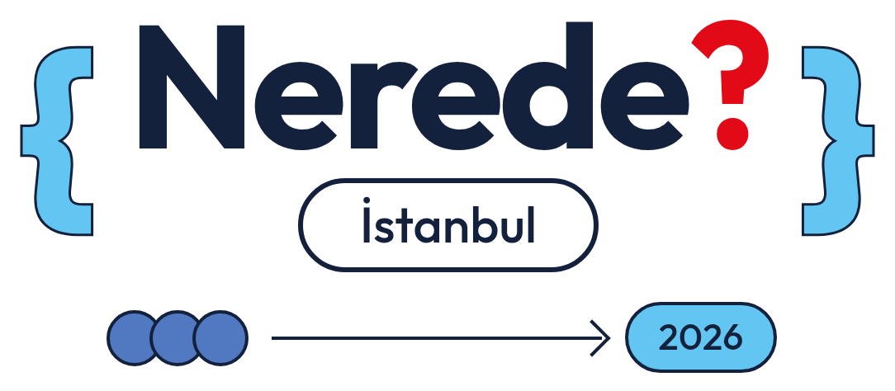
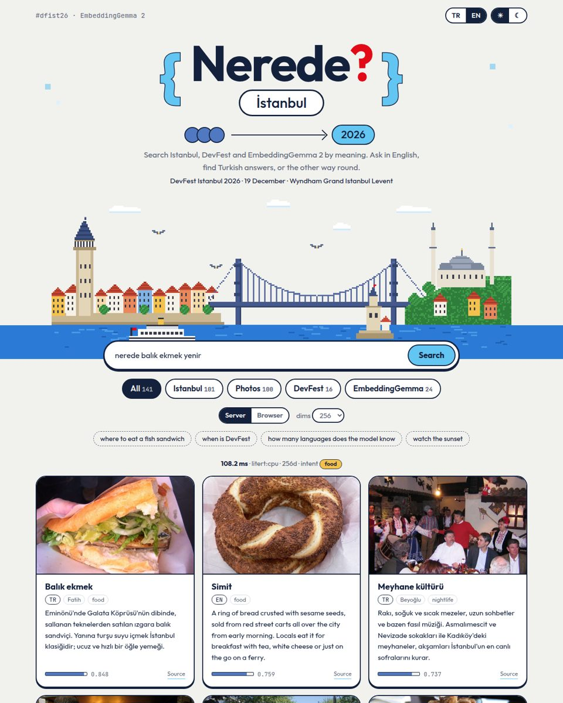
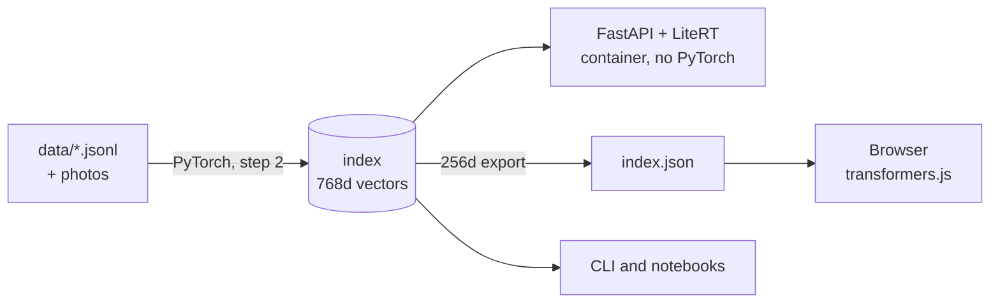

<div align="center">

<picture>
  <source media="(prefers-color-scheme: dark)" srcset="docs/overrides/assets/images/logo-dark.png">
  
</picture>

[](README.md)
[](README.tr.md)

**Build and ship a Turkish-English semantic search with EmbeddingGemma 2.**<br>
A hands-on workshop proposal for GDG DevFest İstanbul 2026 · Wyndham Grand İstanbul Levent

[](https://onuralpszr.github.io/nerede/demo/)
[](https://colab.research.google.com/github/onuralpszr/nerede/blob/main/notebooks/nerede_en.ipynb)
[](https://colab.research.google.com/github/onuralpszr/nerede/blob/main/notebooks/nerede_tr.ipynb)
[](https://kaggle.com/kernels/welcome?src=https://github.com/onuralpszr/nerede/blob/main/notebooks/nerede_en.ipynb)
[](https://kaggle.com/kernels/welcome?src=https://github.com/onuralpszr/nerede/blob/main/notebooks/nerede_tr.ipynb)
[](https://deploy.cloud.run/?git_repo=https://github.com/onuralpszr/nerede.git&revision=main)<br>
[](https://onuralpszr.github.io/nerede/en/)
[](https://onuralpszr.github.io/nerede/tr/)
[](https://github.com/onuralpszr/nerede/actions/workflows/docs.yml)<br>
[](https://huggingface.co/google/embeddinggemma-2)
[](https://www.python.org/)
[](https://github.com/astral-sh/uv)
[](LICENSE)
[](https://devfest.istanbul/)



</div>

Ask *"nerede balık ekmek yenir?"*, *"how do I get to the DevFest venue?"* or *"model kaç dil biliyor?"*. Answers come
from three small collections, matched by meaning rather than keywords: **107 Istanbul places with 106 photos**,
**DevFest İstanbul 2026** and **EmbeddingGemma 2** itself. Turkish questions find English answers, and English questions find Turkish ones.

## One model, three runtimes



The index is built once with PyTorch. LiteRT (165 MB int4) searches it on the server and transformers.js searches it
in the browser. This works because the three runtimes produce the same vectors. Across runtimes the cosine similarity
is 0.98 to 0.99 and recall does not change.

## Quick start

You only need [uv](https://docs.astral.sh/uv/getting-started/installation/), it installs Python for you. Details in [Setup](docs/en/setup.md).

```bash
git clone https://github.com/onuralpszr/nerede && cd nerede
uv run workshop/00_setup_check.py          # downloads the models (~1.7 GB), do it at home
uv run workshop/02_build_index.py --no-images
NEREDE_BACKEND=litert uv run uvicorn app.main:app
```

On Windows PowerShell, set the variable first: `$env:NEREDE_BACKEND = "litert"`, then `uv run uvicorn app.main:app` ([details](docs/en/setup.md#windows)).

Open <http://127.0.0.1:8000>, then switch between **Server** and **Browser** mode. The default install is CPU-only PyTorch
(1.5 GB). For NVIDIA, Intel Arc (XPU), AMD or Apple see [Setup](docs/en/setup.md).

## Free for everyone

| You have | Use |
|---|---|
| any laptop, no GPU | everything runs on CPU |
| only a browser | the Colab notebooks (free tier), including the web app |
| something to share | GitHub Pages: docs + browser-only demo, published by `.github/workflows/docs.yml` |
| a server demo | Hugging Face Spaces, Docker, free CPU (`app_port: 8080`) |
| a Google Cloud account | the **Run on Google Cloud** button above, needs billing, the free tier covers a demo |

## The workshop

| Part | Script | Idea |
|---|---|---|
| 1. Embeddings | `workshop/00_setup_check.py`, `01_hello_embeddings.py` | task prompts, cross-lingual similarity |
| 2. Index and search | `02_build_index.py`, `03_search.py` | a vector index of documents and photos |
| 3. Measure | `04_matryoshka_eval.py` | recall, MRR, Matryoshka 768 → 128 |
| 4. Router | `05_router.py` | zero-shot classification, hybrid search for short queries |
| 5. Runtimes | `06_runtimes.py` | PyTorch vs LiteRT vs OpenVINO, CPU vs GPU |
| 6. Ship it | `app/`, `Dockerfile`, `scripts/docs/build_docs.py` | API, UI, container, free hosting |
| 7. Photos | `03_search.py --photos`, `07_photo_search.py`, `08_image_search.py` | text → photo, photo → place |

## Measurements

On the speaker laptop (Core Ultra X7 358H, Arc B390). Details in [Benchmarks](docs/en/benchmarks.md).

| | |
|---|---|
| recall@1 / recall@3 at 768d (72 mostly cross-lingual questions, 147 docs) | 0.83 / 0.97 |
| recall@3 at 256d, a third of the storage | 0.97 |
| one-word queries ("tatlı", "müze"), relevant in top 5: vector / hybrid | 0.68 / 0.86 |
| search by photo, 27 new photos, right place first / in top 3 | 0.74 / 0.85 |
| query latency: PyTorch CPU / LiteRT CPU / LiteRT GPU / OpenVINO GPU | 23 / 40 / 17 / 6.6 ms |
| photo indexing, 100 photos: CPU / Arc XPU | 257 s / 16 s |
| serving image / cold start / RAM | ~575 MB / 1.1 s / 200 MB |

## Layout

```text
data/       places (TR + EN), DevFest, EmbeddingGemma notes, photos with credits, eval questions
nerede/     the library: prompts, embedders (torch, LiteRT, OpenVINO), index, router
workshop/   numbered steps, one idea each
notebooks/  the same steps for Colab and Kaggle (English and Turkish)
app/        FastAPI server and web UI (server or in-browser inference)
docs/       Zensical site in English and Turkish
scripts/    helpers by kind: draw/ (pixel skyline), data/ (photos), docs/ (site), notebooks/
bench/      measurements and reproductions
```

Build and preview the docs with `uv run --group docs scripts/docs/build_docs.py --with-demo --serve`, then open <http://127.0.0.1:8001> (the app keeps port 8000).

Formatting: `uv run --group dev ruff check --fix . && uv run --group dev ruff format .` for Python, including the code
blocks in the docs, and `npx prettier@3.9.9 --write .` for JS, CSS and HTML. CI checks both.

## Credits

- Code and docs: [Apache 2.0](LICENSE).
- Place texts were written for this workshop and checked against Wikipedia. DevFest facts come from
  [devfest.istanbul](https://devfest.istanbul/). Please report anything that looks wrong.
- Photos: Wikimedia Commons, see [data/images/ATTRIBUTION.md](data/images/ATTRIBUTION.md).
- Fonts: Outfit and JetBrains Mono (SIL Open Font License), self-hosted.
- The look is inspired by the DevFest İstanbul 2026 poster, and the pixel skyline is drawn by `scripts/draw/make_skyline.py`.
- EmbeddingGemma 2 is released by Google DeepMind under Apache 2.0. GDG İstanbul is an independent community group.
