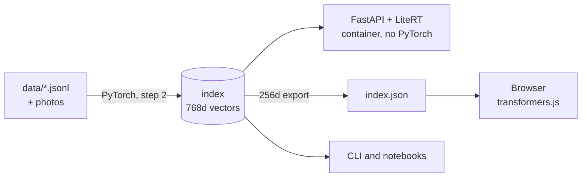

# Nerede?

**Build and ship a Turkish-English semantic search with EmbeddingGemma 2.**
A hands-on workshop proposal for GDG DevFest İstanbul 2026 · 19 December · Wyndham Grand İstanbul Levent.

<p align="center">
  <a href="https://colab.research.google.com/github/onuralpszr/nerede/blob/main/notebooks/nerede_en.ipynb"></a>
  <a href="https://colab.research.google.com/github/onuralpszr/nerede/blob/main/notebooks/nerede_tr.ipynb"></a>
  <a href="https://kaggle.com/kernels/welcome?src=https://github.com/onuralpszr/nerede/blob/main/notebooks/nerede_en.ipynb"></a>
  <br>
  <a href="https://onuralpszr.github.io/nerede/en/"></a>
  <a href="https://onuralpszr.github.io/nerede/tr/"></a>
  <a href="https://onuralpszr.github.io/nerede/demo/"></a>
  <a href="https://github.com/onuralpszr/nerede/actions/workflows/docs.yml"></a>
  <br>
  <a href="https://huggingface.co/google/embeddinggemma-2"></a>
  
  <a href="https://github.com/astral-sh/uv"></a>
  <a href="https://devfest.istanbul/"></a>
</p>

**Docs:** [English](docs/en/index.md) · [Türkçe](docs/tr/index.md) · **Notebooks:** [English](notebooks/nerede_en.ipynb) · [Türkçe](notebooks/nerede_tr.ipynb)

<p align="center">
  
</p>

Ask *"nerede balık ekmek yenir?"*, *"how do I get to the DevFest venue?"* or *"model kaç dil biliyor?"*. Answers come
from three small collections, matched by meaning rather than keywords: **101 Istanbul places with 100 photos**,
**DevFest İstanbul 2026** and **EmbeddingGemma 2** itself. Turkish questions find English answers, and English questions find Turkish ones.

## One model, three runtimes



The index is built once with PyTorch, then queried by LiteRT (165 MB int4) on the server and by transformers.js in
the browser. All three produce the same vectors: cosine 0.98 to 0.99, with the same recall.

## Quick start

```bash
git clone https://github.com/onuralpszr/nerede && cd nerede
uv run workshop/00_setup_check.py          # downloads the models (~1.7 GB), do it at home
uv run workshop/02_build_index.py --no-images
NEREDE_BACKEND=litert uv run uvicorn app.main:app
```

Open <http://127.0.0.1:8000>, then switch between **Server** and **Browser** mode. The default install is CPU-only PyTorch
(1.5 GB). For NVIDIA, Intel Arc (XPU), AMD or Apple see [Setup](docs/en/setup.md).

## Free for everyone

| You have | Use |
|---|---|
| any laptop, no GPU | everything runs on CPU |
| only a browser | the Colab notebooks (free tier), including the web app |
| something to share | GitHub Pages: docs + browser-only demo, published by `.github/workflows/docs.yml` |
| a server demo | Hugging Face Spaces, Docker, free CPU (`app_port: 8080`) |

## The workshop

| Part | Script | Idea |
|---|---|---|
| 1. Embeddings | `workshop/00_setup_check.py`, `01_hello_embeddings.py` | task prompts, cross-lingual similarity |
| 2. Index and search | `02_build_index.py`, `03_search.py` | a vector index of documents and photos |
| 3. Measure | `04_matryoshka_eval.py` | recall, MRR, Matryoshka 768 → 128 |
| 4. Router | `05_router.py` | zero-shot classification |
| 5. Runtimes | `06_runtimes.py` | PyTorch vs LiteRT vs OpenVINO, CPU vs GPU |
| 6. Ship it | `app/`, `Dockerfile`, `scripts/build_docs.py` | API, UI, container, free hosting |
| 7. Photos | `03_search.py --photos`, `07_photo_search.py` | text → photo search |

## What we measured

On the speaker laptop (Core Ultra X7 358H, Arc B390). Details in [Benchmarks](docs/en/benchmarks.md).

| | |
|---|---|
| recall@1 / recall@3 at 768d (66 mostly cross-lingual questions, 141 docs) | 0.86 / 0.98 |
| recall@3 at 256d, a third of the storage | 0.98 |
| query latency: PyTorch CPU / LiteRT CPU / LiteRT GPU / OpenVINO GPU | 23 / 40 / 17 / 6.6 ms |
| photo indexing, 100 photos: CPU / Arc XPU | 257 s / 16 s |
| serving image / cold start / RAM | ~575 MB / 1.1 s / 200 MB |

## Layout

```text
data/       places (TR + EN), DevFest, EmbeddingGemma notes, photos with credits, eval questions
nerede/     the library: prompts, embedders (torch, LiteRT, OpenVINO), index, router
workshop/   numbered steps, one idea each
notebooks/  the same steps for Colab and Kaggle (English and Turkish)
app/        FastAPI server and web UI (server or in-browser inference)
docs/       Zensical site in English and Turkish
scripts/    build docs, generate notebooks, fetch photos, draw the pixel skyline
bench/      measurements and reproductions
```

Build the docs with `uv run --group docs scripts/build_docs.py --with-demo --serve`.

## Credits

- Place texts were written for this workshop and checked against Wikipedia; DevFest facts come from
  [devfest.istanbul](https://devfest.istanbul/). Please report anything that looks wrong.
- Photos: Wikimedia Commons, see [data/images/ATTRIBUTION.md](data/images/ATTRIBUTION.md).
- Fonts: Outfit and JetBrains Mono (SIL Open Font License), self-hosted.
- The look is inspired by the DevFest İstanbul 2026 poster; the pixel skyline is drawn by `scripts/make_skyline.py`.
- EmbeddingGemma 2 is released by Google DeepMind under Apache 2.0. GDG İstanbul is an independent community group.
