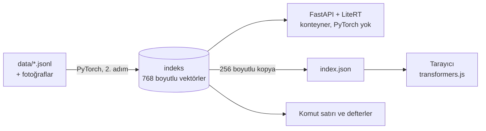

<div align="center">

<picture>
  <source media="(prefers-color-scheme: dark)" srcset="docs/overrides/assets/images/logo-dark.png">
  
</picture>

[](README.md)
[](README.tr.md)

**EmbeddingGemma 2 ile Türkçe-İngilizce anlamsal arama kur ve yayına al.**<br>
GDG DevFest İstanbul 2026 için uygulamalı atölye önerisi · Wyndham Grand İstanbul Levent

[](https://onuralpszr.github.io/nerede/demo/?lang=tr)
[](https://colab.research.google.com/github/onuralpszr/nerede/blob/main/notebooks/nerede_tr.ipynb)
[](https://colab.research.google.com/github/onuralpszr/nerede/blob/main/notebooks/nerede_en.ipynb)
[](https://kaggle.com/kernels/welcome?src=https://github.com/onuralpszr/nerede/blob/main/notebooks/nerede_tr.ipynb)
[](https://kaggle.com/kernels/welcome?src=https://github.com/onuralpszr/nerede/blob/main/notebooks/nerede_en.ipynb)
[](https://deploy.cloud.run/?git_repo=https://github.com/onuralpszr/nerede.git&revision=main)<br>
[](https://onuralpszr.github.io/nerede/tr/)
[](https://onuralpszr.github.io/nerede/en/)
[](https://github.com/onuralpszr/nerede/actions/workflows/docs.yml)<br>
[](https://huggingface.co/google/embeddinggemma-2)
[](https://www.python.org/)
[](https://github.com/astral-sh/uv)
[](LICENSE)
[](https://devfest.istanbul/)


</div>

*"Nerede balık ekmek yenir?"*, *"how do I get to the DevFest venue?"* ya da *"model kaç dil biliyor?"* diye sor. Cevaplar
anahtar kelimeyle değil anlamla eşleşen üç küçük koleksiyondan gelir: **106 fotoğraflı 107 İstanbul mekânı**,
**DevFest İstanbul 2026** ve **EmbeddingGemma 2**'nin kendisi. Türkçe sorular İngilizce cevapları, İngilizce sorular da Türkçe cevapları bulur.

## Tek model, üç runtime



İndeks PyTorch ile bir kez kurulur. Sunucuda LiteRT (165 MB, int4), tarayıcıda transformers.js bu indekste arama yapar.
Bu, üç runtime'ın da aynı vektörleri üretmesi sayesinde mümkün. Runtime'lar arasındaki kosinüs benzerliği 0,98 ile 0,99
arasında, isabet oranı değişmiyor.

## Hızlı başlangıç

Sadece [uv](https://docs.astral.sh/uv/getting-started/installation/) gerekiyor, Python'u o kuruyor. Ayrıntılar [Kurulum](docs/tr/setup.md) sayfasında.

```bash
git clone https://github.com/onuralpszr/nerede && cd nerede
uv run workshop/00_setup_check.py          # modelleri indirir (~1,7 GB), evde yap
uv run workshop/02_build_index.py --no-images
NEREDE_BACKEND=litert uv run uvicorn app.main:app
```

Windows PowerShell'de önce değişkeni ayarla: `$env:NEREDE_BACKEND = "litert"`, sonra `uv run uvicorn app.main:app` ([ayrıntılar](docs/tr/setup.md#windows)).

<http://127.0.0.1:8000> adresini aç, sonra **Sunucu** ve **Tarayıcı** modları arasında geçiş yap. Varsayılan kurulum yalnızca
CPU'lu PyTorch'tur (1,5 GB). NVIDIA, Intel Arc (XPU), AMD ya da Apple için [Kurulum](docs/tr/setup.md) sayfasına bak.

## Herkes için ücretsiz

| Elinde ne var | Ne kullan |
|---|---|
| herhangi bir dizüstü, GPU yok | her şey CPU'da çalışır |
| sadece bir tarayıcı | Colab defterleri (ücretsiz katman), web uygulaması dahil |
| paylaşacak bir şey | GitHub Pages: belgeler + tarayıcıda çalışan demo, `.github/workflows/docs.yml` ile yayınlanır |
| sunuculu bir demo | Hugging Face Spaces, Docker, ücretsiz CPU (`app_port: 8080`) |
| bir Google Cloud hesabı | yukarıdaki **Run on Google Cloud** düğmesi, faturalandırma ister, ücretsiz kota bir demoyu karşılar |

## Atölye

| Bölüm | Betik | Fikir |
|---|---|---|
| 1. Embedding'ler | `workshop/00_setup_check.py`, `01_hello_embeddings.py` | görev önekleri, diller arası benzerlik |
| 2. İndeks ve arama | `02_build_index.py`, `03_search.py` | belgeler ve fotoğraflar için vektör indeksi |
| 3. Ölç | `04_matryoshka_eval.py` | recall, MRR, Matryoshka 768 → 128 |
| 4. Yönlendirici | `05_router.py` | sıfır-örnek sınıflandırma, kısa sorgular için hibrit arama |
| 5. Runtime'lar | `06_runtimes.py` | PyTorch, LiteRT ve OpenVINO, CPU ve GPU |
| 6. Yayına al | `app/`, `Dockerfile`, `scripts/docs/build_docs.py` | API, arayüz, konteyner, ücretsiz barındırma |
| 7. Fotoğraflar | `03_search.py --photos`, `07_photo_search.py`, `08_image_search.py` | metinden fotoğrafa, fotoğraftan yere |

## Ölçümler

Konuşmacının dizüstünde (Core Ultra X7 358H, Arc B390). Ayrıntılar [Ölçümler](docs/tr/benchmarks.md) sayfasında.

| | |
|---|---|
| 768 boyutta recall@1 / recall@3 (çoğu diller arası 72 soru, 147 belge) | 0,83 / 0,97 |
| 256 boyutta recall@3, depolamanın üçte biriyle | 0,97 |
| tek kelimelik sorgular ("tatlı", "müze"), ilk 5'te doğru olan: vektör / hibrit | 0,68 / 0,86 |
| fotoğrafla arama, 27 yeni fotoğraf, doğru yer ilk sırada / ilk 3'te | 0,74 / 0,85 |
| sorgu gecikmesi: PyTorch CPU / LiteRT CPU / LiteRT GPU / OpenVINO GPU | 23 / 40 / 17 / 6,6 ms |
| 100 fotoğrafı indeksleme: CPU / Arc XPU | 257 sn / 16 sn |
| sunucu imajı / soğuk açılış / RAM | ~575 MB / 1,1 sn / 200 MB |

## Klasörler

```text
data/       mekânlar (TR + EN), DevFest, EmbeddingGemma notları, kaynaklı fotoğraflar, değerlendirme soruları
nerede/     kütüphane: önekler, embedder'lar (torch, LiteRT, OpenVINO), indeks, yönlendirici
workshop/   numaralı adımlar, her biri tek bir fikir
notebooks/  aynı adımlar Colab ve Kaggle için (Türkçe ve İngilizce)
app/        FastAPI sunucusu ve web arayüzü (sunucuda ya da tarayıcıda çıkarım)
docs/       Türkçe ve İngilizce Zensical sitesi
scripts/    türe göre yardımcılar: draw/ (piksel siluet), data/ (fotoğraflar), docs/ (site), notebooks/
bench/      ölçümler ve hata yeniden üretimleri
```

Belgeleri `uv run --group docs scripts/docs/build_docs.py --with-demo --serve` ile derleyip <http://127.0.0.1:8001> adresinden önizle (uygulama 8000 portunu kullanmaya devam eder).

Biçimlendirme: Python için, belgelerdeki kod blokları dahil, `uv run --group dev ruff check --fix . && uv run --group dev ruff format .`,
JS, CSS ve HTML için `npx prettier@3.9.9 --write .`. CI ikisini de kontrol eder.

## Teşekkürler

- Kod ve belgeler: [Apache 2.0](LICENSE).
- Mekân metinleri bu atölye için yazıldı ve Wikipedia ile karşılaştırılarak kontrol edildi. DevFest bilgileri
  [devfest.istanbul](https://devfest.istanbul/) sitesinden. Yanlış görünen bir şey varsa lütfen bildir.
- Fotoğraflar: Wikimedia Commons, bkz. [data/images/ATTRIBUTION.md](data/images/ATTRIBUTION.md).
- Yazı tipleri: Outfit ve JetBrains Mono (SIL Open Font License), sitenin içinde barındırılıyor.
- Görünüm DevFest İstanbul 2026 afişinden esinlendi, piksel siluet ise `scripts/draw/make_skyline.py` ile çiziliyor.
- EmbeddingGemma 2, Google DeepMind tarafından Apache 2.0 lisansıyla yayınlandı. GDG İstanbul bağımsız bir topluluk grubudur.
