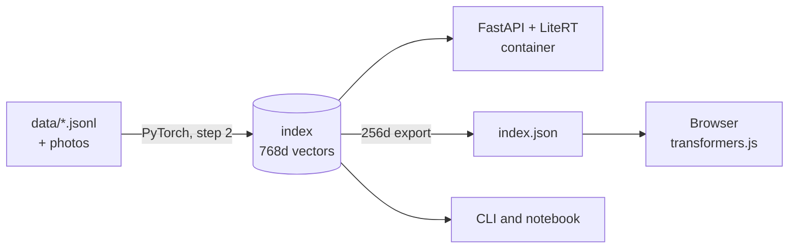

<div class="nd-hero" markdown>
<div class="nd-brand"><span class="nd-brace">{</span><div class="nd-mid"><h1>Nerede<span>?</span></h1><div class="nd-pill">İstanbul</div></div><span class="nd-brace">}</span></div>
<div class="nd-time"><span><i></i><i></i><i></i></span><b></b><em>2026</em></div>

**Build and ship a Turkish-English semantic search with EmbeddingGemma 2.**
A hands-on workshop proposal for GDG DevFest İstanbul 2026 · 19 December · Wyndham Grand İstanbul Levent


</div>

Ask *"nerede balık ekmek yenir?"*, *"when is DevFest?"* or *"how big is the model?"* and get answers from
three small collections, matched by meaning rather than keywords: **Istanbul places** (with photos), **DevFest İstanbul 2026**
and **EmbeddingGemma 2** itself. Turkish questions find English answers, and English questions find Turkish ones.

<div class="grid cards" markdown>

-   :material-language-python:{ .lg } **Python first**

    ---

    Embed, index, evaluate and route with `sentence-transformers` in a few dozen lines.

    [:octicons-arrow-right-24: Workshop](workshop/index.md)

-   :material-cellphone-link:{ .lg } **LiteRT**

    ---

    The same model as a 165 MB int4 file. No PyTorch, loads in 0.3 s, and the container starts in about a second.

    [:octicons-arrow-right-24: Runtimes](workshop/5-runtimes.md)

-   :material-web:{ .lg } **In the browser**

    ---

    transformers.js on WebGPU. The query never leaves the device, and the whole demo can be hosted for free as static files.

    [:octicons-arrow-right-24: Ship it](workshop/6-ship.md)

-   :material-image-search:{ .lg } **Photos too**

    ---

    Photos and text share one vector space: index Istanbul photos once, then search them with plain words.

    [:octicons-arrow-right-24: Photo search](workshop/7-photos.md)

</div>

## Quick start

```bash
git clone https://github.com/onuralpszr/nerede && cd nerede
uv run workshop/00_setup_check.py      # downloads the models, run it at home
uv run workshop/02_build_index.py      # embeds ~140 docs and the photos
NEREDE_BACKEND=litert uv run uvicorn app.main:app
```

Open <http://127.0.0.1:8000> and switch between **Server** and **Browser** mode.

!!! tip "No laptop power, no credit card?"
    Everything in this workshop runs for free: on any laptop CPU, in the [Colab notebook](colab.md),
    or as a static site on GitHub Pages. See [Free options](free.md).

## One model, three runtimes



The index is built once with PyTorch, then queried by LiteRT on the server and by transformers.js in the browser.
That only works because all three produce **the same vectors**, which we measured: cosine 0.98 to 0.99 between runtimes, with the same recall.

## Agenda (~100 minutes)

| Time | Part | You will |
|---|---|---|
| 0:00 | Intro | Learn what embeddings are and what is new in EmbeddingGemma 2 |
| 0:10 | [1. Embeddings](workshop/1-embeddings.md) | Embed sentences, use task prompts, search across languages |
| 0:20 | [2. Index and search](workshop/2-search.md) | Build a vector index of places, DevFest facts and model docs |
| 0:35 | [3. Measure](workshop/3-measure.md) | Evaluate recall at 768, 512, 256 and 128 dimensions |
| 0:50 | [4. Router](workshop/4-router.md) | Classify questions with no training data |
| 0:60 | [5. Runtimes](workshop/5-runtimes.md) | Compare PyTorch, LiteRT and OpenVINO on CPU and GPU |
| 0:70 | [6. Ship it](workshop/6-ship.md) | Run the API and UI, build a container, publish for free |
| 0:90 | [7. Photos](workshop/7-photos.md) | Search photos with words |
