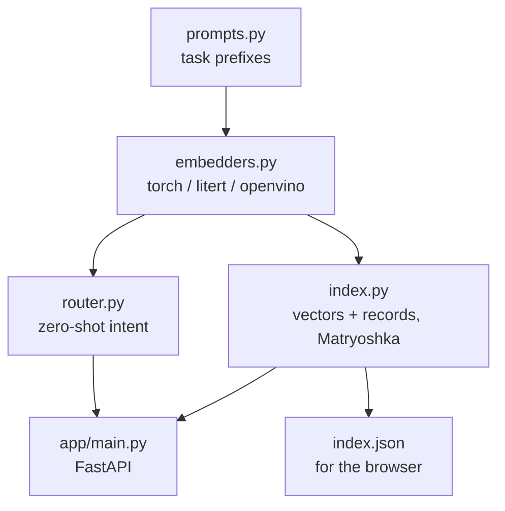

# Workshop overview

Seven short parts in 60 minutes. Each one is a small script in `workshop/` (and a section in the
[Colab notebook](../colab.md)), and each introduces one idea. Run them in order. If you fall behind, the finished
code is already there, so just run the next one. Parts 5 and 7 are speaker demos in the room, but you can try them at home.

| Part | Script | Idea | Time |
|---|---|---|---|
| [1. Embeddings](1-embeddings.md) | `00_setup_check.py`, `01_hello_embeddings.py` | vectors, task prompts, cross-lingual similarity | 8 min |
| [2. Index and search](2-search.md) | `02_build_index.py`, `03_search.py` | a vector index of documents and photos | 10 min |
| [3. Measure](3-measure.md) | `04_matryoshka_eval.py` | recall, MRR, Matryoshka trade-offs | 7 min |
| [4. Router](4-router.md) | `05_router.py` | zero-shot classification, hybrid search | 7 min |
| [5. Runtimes](5-runtimes.md) | `06_runtimes.py` | PyTorch vs LiteRT vs OpenVINO, CPU vs GPU | 5 min, demo |
| [6. Ship it](6-ship.md) | `app/`, `Dockerfile` | API, UI, container, free hosting | 10 min |
| [7. Photo search](7-photos.md) | `07_photo_search.py`, `08_image_search.py` | text → photo and photo → place | 5 min, demo |

## The data

| Collection | Size | Languages | Source |
|---|---|---|---|
| `places` | 107 Istanbul places, food and tips | 55 TR, 52 EN | written for the workshop, fact-checked against Wikipedia |
| `devfest` | 12 facts about DevFest İstanbul 2026 and GDG İstanbul | 6 TR, 6 EN | devfest.istanbul |
| `devfest2025` | 4 facts about last year's DevFest | 2 TR, 2 EN | devfest.istanbul archive, Webrazzi |
| `gemma` | 24 notes about EmbeddingGemma 2 | 12 TR, 12 EN | model card and Google blog posts |
| photos | 106, one for almost every place | none | Wikimedia Commons, free licenses |
| eval | 72 labelled questions | mixed | most are cross-lingual |

More in [Dataset](../dataset.md).

## The library in one picture

Every embedder has the same interface: `embed(list[str]) -> np.ndarray` of shape `(n, 768)`, L2-normalized.
That is why one index works with all of them.
