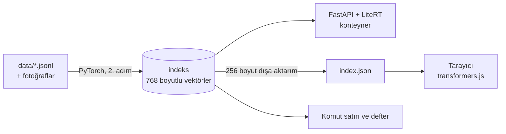

<div class="nd-hero" markdown>
<div class="nd-brand"><span class="nd-brace">{</span><div class="nd-mid"><h1>Nerede<span>?</span></h1><div class="nd-pill">İstanbul</div></div><span class="nd-brace">}</span></div>
<div class="nd-time"><span><i></i><i></i><i></i></span><b></b><em>2026</em></div>

**EmbeddingGemma 2 ile Türkçe-İngilizce anlamsal arama kur ve yayına al.**
GDG DevFest İstanbul 2026 için uygulamalı atölye önerisi · 19 Aralık · Wyndham Grand İstanbul Levent

[Canlı demoyu dene](../demo/){ .md-button .md-button--primary } [Atölyeye başla](workshop/index.md){ .md-button }


</div>

*"nerede balık ekmek yenir?"*, *"when is DevFest?"* ya da *"model ne kadar büyük?"* diye sor; cevaplar anahtar
kelimeyle değil **anlamla** üç küçük koleksiyondan gelsin: **İstanbul'daki yerler** (fotoğraflarıyla), **DevFest İstanbul 2026**
ve **EmbeddingGemma 2**'nin kendisi. Türkçe soru İngilizce cevabı, İngilizce soru Türkçe cevabı bulur.

<div class="grid cards" markdown>

-   :material-language-python:{ .lg } **Önce Python**

    ---

    `sentence-transformers` ile birkaç düzine satırda embedding, indeks, ölçüm ve yönlendirme.

    [:octicons-arrow-right-24: Atölye](workshop/index.md)

-   :material-cellphone-link:{ .lg } **LiteRT**

    ---

    Aynı model, 165 MB'lık int4 dosya olarak. PyTorch yok, 0,3 saniyede yüklenir, konteyner yaklaşık bir saniyede açılır.

    [:octicons-arrow-right-24: Runtime'lar](workshop/5-runtimes.md)

-   :material-web:{ .lg } **Tarayıcıda**

    ---

    WebGPU üzerinde transformers.js. Sorgu cihazdan çıkmaz; tüm demo statik dosya olarak ücretsiz yayınlanabilir.

    [:octicons-arrow-right-24: Yayına al](workshop/6-ship.md)

-   :material-image-search:{ .lg } **Fotoğraflar da**

    ---

    Fotoğraf ve metin aynı vektör uzayında: İstanbul fotoğraflarını bir kez indeksle, sonra kelimelerle ara.

    [:octicons-arrow-right-24: Fotoğraf arama](workshop/7-photos.md)

</div>

## Hızlı başlangıç

Sadece [uv](https://docs.astral.sh/uv/getting-started/installation/) gerekiyor, Python'u o kuruyor. Ayrıntılar [Kurulum](setup.md) sayfasında.

```bash
git clone https://github.com/onuralpszr/nerede && cd nerede
uv run workshop/00_setup_check.py              # modelleri indirir, evde çalıştır
uv run workshop/02_build_index.py --no-images  # 147 belgeyi gömer, hazır fotoğraf vektörlerini korur
NEREDE_BACKEND=litert uv run uvicorn app.main:app
```

Windows PowerShell'de önce değişkeni ayarla: `$env:NEREDE_BACKEND = "litert"`, sonra `uv run uvicorn app.main:app` ([ayrıntılar](setup.md#windows)).

<http://127.0.0.1:8000> adresini aç ve **Sunucu** ile **Tarayıcı** modu arasında geçiş yap.

!!! tip "Güçlü bilgisayarın ya da kredi kartın yok mu?"
    Bu atölyedeki her şey ücretsiz çalışır: herhangi bir dizüstü işlemcisinde, [Colab defterinde](colab.md)
    ya da GitHub Pages üzerinde statik site olarak. Bkz. [Ücretsiz seçenekler](free.md).

## Bir model, üç runtime



İndeks PyTorch ile bir kez kurulur; sunucuda LiteRT, tarayıcıda transformers.js ile sorgulanır.
Bu ancak üçü de **aynı vektörleri** ürettiği için mümkün; ölçtük: runtime'lar arasında kosinüs benzerliği 0,98-0,99, isabet oranı aynı.

## Akış (~100 dakika)

| Süre | Bölüm | Yapacakların |
|---|---|---|
| 0:00 | Giriş | Embedding nedir, EmbeddingGemma 2'de ne yeni |
| 0:10 | [1. Embedding'ler](workshop/1-embeddings.md) | Cümleleri göm, görev öneklerini kullan, diller arası ara |
| 0:20 | [2. İndeks ve arama](workshop/2-search.md) | Yerler, DevFest bilgileri ve model notlarından vektör indeksi kur |
| 0:35 | [3. Ölçüm](workshop/3-measure.md) | 768, 512, 256 ve 128 boyutta isabeti ölç |
| 0:50 | [4. Yönlendirici](workshop/4-router.md) | Eğitim verisi olmadan soruları sınıflandır |
| 1:00 | [5. Runtime'lar](workshop/5-runtimes.md) | PyTorch, LiteRT ve OpenVINO'yu CPU ve GPU'da karşılaştır |
| 1:10 | [6. Yayına al](workshop/6-ship.md) | API ve arayüzü çalıştır, konteyner kur, ücretsiz yayınla |
| 1:30 | [7. Fotoğraflar](workshop/7-photos.md) | Fotoğrafları kelimelerle ara |
