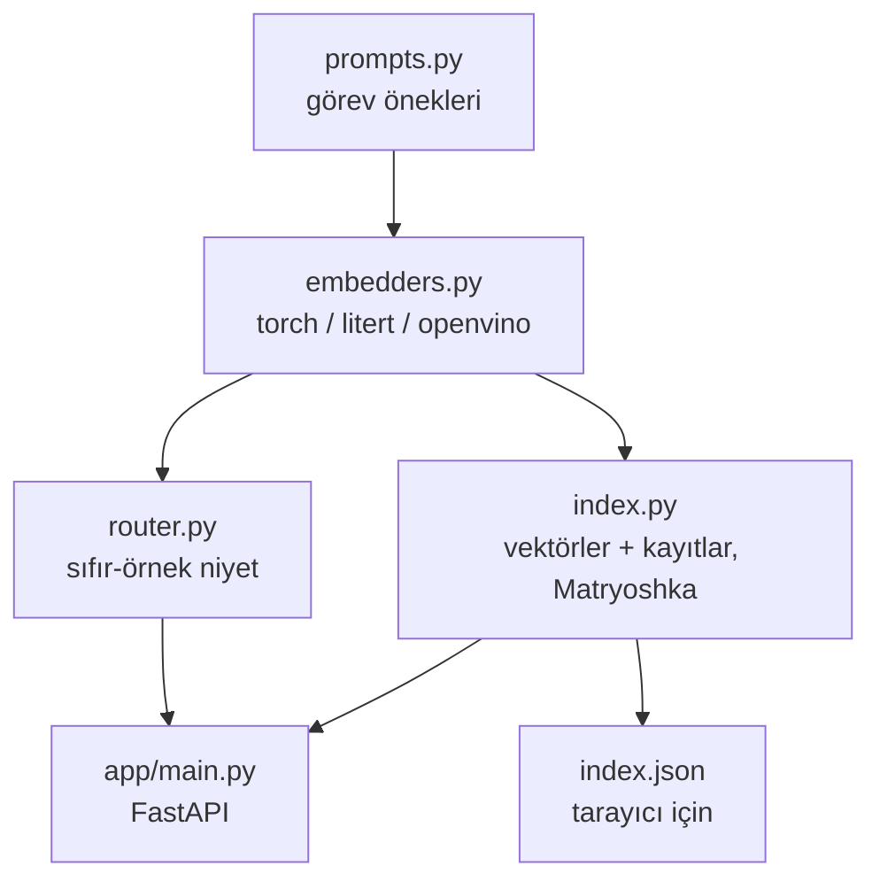

# Atölyeye genel bakış

60 dakikada yedi kısa bölüm. Her biri `workshop/` altında küçük bir betik (ve [Colab defterinde](../colab.md)
bir bölüm), her biri tek bir fikri anlatır. Sırayla çalıştır. Geride kalırsan dert etme: bitmiş kod zaten orada,
bir sonrakini çalıştırman yeter. 5. ve 7. bölümleri salonda konuşmacı gösteriyor, ama evde sen de dene.

| Bölüm | Betik | Fikir | Süre |
|---|---|---|---|
| [1. Embedding'ler](1-embeddings.md) | `00_setup_check.py`, `01_hello_embeddings.py` | vektörler, görev önekleri, diller arası benzerlik | 8 dk |
| [2. İndeks ve arama](2-search.md) | `02_build_index.py`, `03_search.py` | belgeler ve fotoğraflar için vektör indeksi | 10 dk |
| [3. Ölçüm](3-measure.md) | `04_matryoshka_eval.py` | isabet, MRR, Matryoshka ödünleşimi | 7 dk |
| [4. Yönlendirici](4-router.md) | `05_router.py` | sıfır-örnekle sınıflandırma, hibrit arama | 7 dk |
| [5. Runtime'lar](5-runtimes.md) | `06_runtimes.py` | PyTorch, LiteRT, OpenVINO, CPU ve GPU | 5 dk, demo |
| [6. Yayına al](6-ship.md) | `app/`, `Dockerfile` | API, arayüz, konteyner, ücretsiz yayın | 10 dk |
| [7. Fotoğraf arama](7-photos.md) | `07_photo_search.py`, `08_image_search.py` | metinden fotoğrafa, fotoğraftan yere | 5 dk, demo |

## Veri

| Koleksiyon | Boyut | Diller | Kaynak |
|---|---|---|---|
| `places` | 107 İstanbul yeri, yemek ve ipucu | 55 TR, 52 EN | atölye için yazıldı, Wikipedia'dan doğrulandı |
| `devfest` | DevFest İstanbul 2026 ve GDG İstanbul hakkında 12 bilgi | 6 TR, 6 EN | devfest.istanbul |
| `devfest2025` | geçen yılki DevFest hakkında 4 bilgi | 2 TR, 2 EN | devfest.istanbul arşivi, Webrazzi |
| `gemma` | EmbeddingGemma 2 hakkında 24 not | 12 TR, 12 EN | model kartı ve Google blog yazıları |
| fotoğraflar | 106, neredeyse her yere bir tane | yok | Wikimedia Commons, özgür lisanslar |
| değerlendirme | 72 etiketli soru | karışık | çoğu diller arası |

Ayrıntılar [Veri seti](../dataset.md) sayfasında.

## Kütüphane tek resimde

Her embedder aynı arayüze sahip: `embed(list[str]) -> np.ndarray`, boyutu `(n, 768)`, L2 normalize edilmiş.
Tek bir indeksin hepsiyle çalışmasının sebebi bu.
